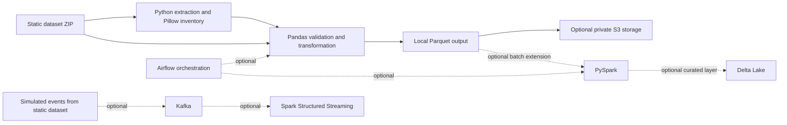

# Polygon Image Data Engineering Platform

A data engineering project for ingesting polygon PNG images with `targets.csv`, validating and enriching their metadata, and storing structured outputs. The focus is reliable data ingestion and storage, not model training.

## Current status

Phases 1–4 are implemented in code: ZIP extraction, image inventory, metadata/image quality validation, a standalone CA1 Pandas-to-Parquet pipeline, and opt-in S3 upload/verification. Optional Spark batch, Delta Lake, Kafka streaming, and Airflow orchestration code plus Docker Compose profiles are also implemented. Advanced containers have not been run because the Docker daemon is inaccessible in this environment; the S3 path has not been run against AWS. See the [compatibility matrix](docs/compatibility_matrix.md) and [advanced services guide](docs/advanced_services.md).

## Intended architecture



The full end-to-end path is orchestrated by the Airflow DAG and carries each run from ZIP ingestion through validation, Pandas/Parquet, Spark batch summaries, Kafka event simulation, Structured Streaming, Delta Lake, and final verification. The mandatory CA1 segment also remains independently runnable with Python, Pandas, Pillow, PyArrow, and Boto3, as required by the assignment; that standalone path is a usable baseline, not the full platform. Local storage is the default so a cloud account is not required. AWS S3 integration is opt-in and uses environment/profile-based credentials and least-privilege IAM.

The advanced path is optional. Its Docker Compose profiles provide Spark batch processing, Airflow orchestration, simulated Kafka events, Spark Structured Streaming, and Delta Lake. These services are not dependencies of the CA1 path.

## Phase 0 setup

Use a project virtual environment and install the baseline dependencies:

```bash
python3.10 -m venv .venv
source .venv/bin/activate
python -m pip install --upgrade pip
python -m pip install -r requirements-ca1.txt
python scripts/check_environment.py
```

Copy the dataset ZIP to `data/raw/polygon_dataset.zip`. Raw data and generated outputs are excluded from Git. Copy `.env.example` to `.env` only when local configuration is needed; never put AWS keys in either file.

## Phase 1: extract and inventory

Run from the repository root:

```bash
python scripts/ingest_dataset.py --dataset-zip data/raw/polygon_dataset.zip --run-id local-demo
```

The script discovers the CSV and PNG files inside the archive, safely extracts only those data files, and records image dimensions, mode, format, byte size, and decode status. It ignores `__MACOSX` and AppleDouble metadata, does not overwrite an existing run directory, and retains invalid-image records in the manifest with their error messages. Each run writes `image_manifest.csv` and `ingestion_summary.json` under `data/staging/<run-id>/`, which is Git-ignored.

The supplied archive was run through this command with the following observed result: 10,001 data files extracted (one CSV and 10,000 PNGs), 10,005 macOS metadata entries skipped, 10,000 CSV rows, and 10,000 valid 128 × 128 RGB PNG images. The output was written to `data/staging/phase1-initial/` and remains local.

## Phase 2: validate and reconcile

```bash
python scripts/validate_dataset.py --run-dir data/staging/<run-id>
```

This generates `quality_report.json` and `validation_issues.csv`. It checks required columns, missing values, filename duplicates, numeric types/domains, redundant index columns, image integrity, metadata/image matches, image coordinates, and advisory circle/rotation boundaries. It does not drop records or fill missing values. The supplied ZIP had no validation errors, 10,000 exact filename matches, and 795 warnings: 789 circle extents crossing the image boundary and 6 rotations at 360 degrees. Edge-crossing circles remain warnings pending a domain decision.

## Phase 3: standalone CA1 Pandas and Parquet

```bash
python scripts/run_ca1.py --dataset-zip data/raw/polygon_dataset.zip --run-id ca1-demo
```

This runs extraction, validation, Pandas transformation, and local Parquet writing as one command. It stops if validation finds errors; warnings are retained in reports. It verifies the redundant index is exactly `0..n-1` before removing it, trims filenames and color labels, casts numeric fields to `int64`, normalizes 360-degree rotations to 0, and enriches metadata with image properties. It does not impute values or drop rows. Parquet outputs use Snappy compression and are read back to check row counts, columns, and data types.

For the supplied ZIP, the full local CA1 command completed with 10,000 input/output rows and six Parquet outputs: `image_metadata`, `polygon_distribution`, `color_distribution`, `color_pairs`, `rotation_summary`, and `image_quality_summary`. It required no AWS credentials or services.

## Phase 4: optional AWS S3 upload

The uploader targets an existing bucket and never creates buckets or changes public-access settings. Review [AWS configuration](docs/aws_configuration.md) first. The local mode remains the default and does not contact AWS. To explicitly upload a complete run (including the raw PNGs), configure an AWS profile and then run:

```bash
python scripts/run_ca1.py \
  --dataset-zip data/raw/polygon_dataset.zip \
  --run-id ca1-s3-demo \
  --storage-backend s3 \
  --bucket your-existing-private-bucket \
  --profile polygon-pipeline \
  --region ap-south-1
```

This uploads thousands of objects and AWS storage/request charges may apply. No S3 upload or cloud resource creation has been performed as part of this implementation.

## Full end-to-end execution

For the complete orchestrated platform, follow [the full-stack guide](docs/advanced_services.md). It starts the `full` Compose profile and triggers the `polygon_image_end_to_end_pipeline` Airflow DAG. Each successful DAG run records a `pipeline_run_summary.json` alongside the ingested data, quality reports, CA1 Parquet, Spark summaries, streaming archive, and Delta table. This full service path still needs a runtime run with Docker Desktop available; syntax and Compose configuration have been checked, but service execution is not claimed yet.

## Implemented extensions and remaining work

1. Dataset discovery, safe extraction, and image inventory — implemented and run.
2. Metadata/image validation and a quality report — implemented and run.
3. Standalone CA1 Pandas transformation and local Parquet read-back — implemented and run.
4. Optional S3 upload and verification — code implemented; AWS execution pending user configuration/authorization.
5. Optional Docker Compose profiles — implemented; needs container startup verification.
6. Optional PySpark batch processing — implemented; needs Spark execution verification.
7. Optional Airflow orchestration — implemented; needs Airflow DAG parsing and run verification.
8. Optional Kafka event simulation — implemented; needs broker run verification.
9. Optional Spark Structured Streaming — implemented; needs end-to-end verification.
10. Optional Delta Lake curated tables — implemented; needs Delta execution verification.
11. Pytest coverage, operations documentation, CA1 report, and demo checklist — remaining.

Execution counts above are from actual local runs on the supplied archive. No AWS or advanced-service success is claimed.
