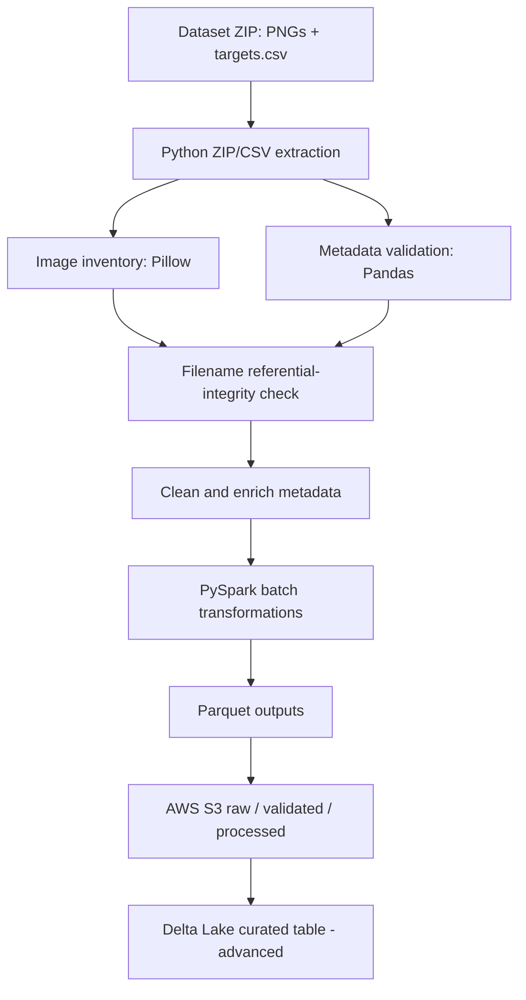
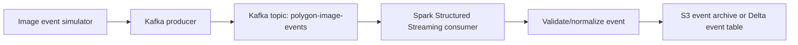
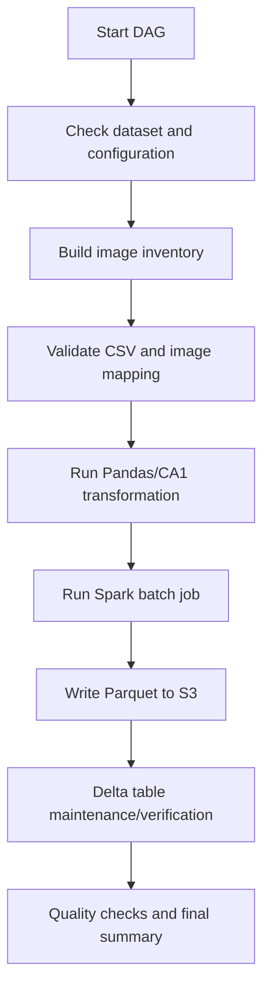

# Polygon Image Data Engineering Platform — Full Implementation Plan

## 0. Project intent and delivery strategy

**Project:** Polygon Image Data Engineering Platform  
**Source:** Supplied polygon dataset ZIP containing PNG images and `targets.csv`  
**Primary cloud destination:** Amazon S3  
**Learning choice:** Full technology stack; implementation style: fast, with Codex doing most implementation and the student reviewing, running, and understanding each subsystem.

Build a working end-to-end platform that ingests image assets and metadata, validates and enriches them, performs batch processing with Apache Spark, orchestrates workflows with Apache Airflow, demonstrates event streaming with Apache Kafka, stores raw and curated data in Amazon S3, and explores ACID table management with Delta Lake.

### Critical delivery rule

The CA1 assignment remains the acceptance baseline. It explicitly asks for a data source, extraction, Pandas transformation/cleaning, target storage in S3/GCS, a 3–5 page technical report, execution evidence, and cloud-storage proof. Therefore:

- **CA1 path must work independently and be demonstrable:** Python/Pandas extraction and cleaning → Parquet → AWS S3, with logs and screenshots.
- **Full-stack learning path extends the baseline:** Docker, Spark, Airflow, Kafka, and Delta Lake.
- Do not let an advanced component block delivery of the CA1 baseline.
- Keep a clearly documented `ca1` execution mode and a `full` execution mode.

The supplied assignment describes a simple data source → extraction → Pandas transformation → S3 flow. It does not require Kafka, Spark, Airflow, or Delta Lake. These are learning extensions, not claims about the marking rubric.

## 1. Dataset profile and assumptions to verify

The supplied archive was previously inspected and reported to contain:
- 10,000 PNG images.
- 10,000 rows in `targets.csv`.
- 9 CSV columns.
- No missing CSV values in the inspected copy.
- No duplicate filenames in the inspected CSV.
- All CSV filenames matched image files in the inspected archive.
- Sampled PNGs were 128 × 128 RGB.

Treat these as observed properties of this supplied archive, not hardcoded truths. Recalculate them during every run and report actual counts.

Metadata fields:
- `Unnamed: 0` — likely exported index; verify it is redundant before dropping.
- `filename`
- `sides`
- `bg_color`
- `fg_color`
- `bound_circle_x`
- `bound_circle_y`
- `bound_circle_r`
- `rotation`

The pipeline must inspect the actual ZIP structure, ignore `__MACOSX` and other non-dataset archive entries, and avoid assuming a fixed nested folder path. Resolve the image root by discovery and validation.

The dataset contains images plus metadata. PNG files remain image assets; do not attempt to convert image binaries to Parquet. Store structured metadata and analytics in Parquet/Delta.

## 2. Learning outcomes

By completion, understand and be able to explain:
- Batch ingestion versus event streaming.
- Raw, validated, curated, and analytics data layers.
- Data quality checks and metadata-to-image referential integrity.
- Pandas DataFrames versus Spark DataFrames.
- Spark transformations, actions, partitions, and Parquet.
- Kafka brokers, topics, partitions, producers, consumers, offsets, and consumer groups.
- Airflow DAGs, operators/tasks, dependencies, scheduling, retries, and task logs.
- Docker images, containers, volumes, networks, health checks, and Compose.
- S3 buckets, object keys/prefixes, IAM least privilege, Boto3, and S3A access from Spark.
- Delta Lake tables, transaction log, ACID operations, schema enforcement/evolution, and time travel.
- Unit tests, integration tests, idempotency, observability, and recovery.

## 3. Target architecture

### 3.1 Batch path — required for CA1 and the main data product



### 3.2 Streaming learning path — Kafka + Spark Structured Streaming



The streaming extension simulates events about images already in the dataset. It does not claim that the original ZIP is a live feed. Define an event schema with `event_id`, `filename`, `event_type`, `event_timestamp`, and optional validation metadata. Use deterministic event IDs so duplicate delivery can be detected.

### 3.3 Orchestration path — Airflow



Airflow orchestrates batch tasks and monitors dependencies. Kafka handles event transport. Spark performs distributed processing. Do not use Airflow as a message broker or Kafka as a data lake.

## 4. Technology stack and responsibilities

| Technology | Role in this project | Priority |
|---|---|---|
| Python | Pipeline code, utilities, event producer | Required |
| Pandas | CA1 extraction/cleaning and reference implementation | Required |
| Pillow | Inspect and verify PNG assets | Required |
| PyArrow | Local Parquet generation/read-back | Required |
| AWS S3 | Raw image and processed-data object storage | Required |
| Boto3 | Upload/list/download/verify S3 objects | Required |
| Docker + Compose | Reproducible local services | Full-stack |
| Apache Spark / PySpark | Distributed batch processing and Parquet writes | Full-stack |
| Apache Airflow | DAG orchestration, retries, task monitoring | Full-stack |
| Apache Kafka | Simulated image lifecycle events | Full-stack |
| Spark Structured Streaming | Consume Kafka events and persist event output | Full-stack |
| Delta Lake | ACID curated metadata/event tables on S3 | Advanced full-stack |
| Pytest | Unit and integration testing | Required |
| Makefile or task runner | Consistent commands | Recommended |

Codex must select mutually compatible versions for Python, Java, Spark, Airflow, Kafka, Delta Lake, and Hadoop AWS/S3A dependencies. It must document the chosen compatibility matrix and validate it against official project documentation before pinning versions. Do not blindly install `latest` versions.

## 5. Repository structure

```text
polygon-image-data-platform/
├── data/                         # local only; gitignored
│   ├── raw/
│   │   ├── polygon_dataset.zip
│   │   ├── targets.csv
│   │   └── images/
│   ├── staging/
│   └── processed/
├── dags/
│   └── polygon_pipeline_dag.py
├── src/
│   ├── common/
│   │   ├── config.py
│   │   ├── logging_config.py
│   │   └── schemas.py
│   ├── ingestion/
│   │   ├── extract_zip.py
│   │   ├── extract_csv.py
│   │   └── image_inventory.py
│   ├── validation/
│   │   ├── validate_metadata.py
│   │   ├── validate_images.py
│   │   └── reconcile_assets.py
│   ├── transformation/
│   │   ├── pandas_transform.py
│   │   ├── spark_batch.py
│   │   └── aggregates.py
│   ├── storage/
│   │   ├── local_parquet.py
│   │   ├── s3_storage.py
│   │   └── delta_storage.py
│   ├── streaming/
│   │   ├── event_schema.py
│   │   ├── producer.py
│   │   └── spark_streaming_consumer.py
│   └── pipeline.py
├── tests/
│   ├── unit/
│   ├── integration/
│   └── fixtures/
├── docker/
│   ├── airflow/
│   ├── spark/
│   └── kafka/
├── scripts/
│   ├── check_environment.py
│   ├── create_bucket_instructions.md
│   └── verify_s3.py
├── docs/
│   ├── architecture.md
│   ├── data_dictionary.md
│   ├── compatibility_matrix.md
│   ├── operations_runbook.md
│   └── ca1_evidence_checklist.md
├── docker-compose.yml
├── Dockerfile                  # only if a custom application image is needed
├── Makefile
├── requirements.txt            # or split requirements by service
├── .env.example
├── .gitignore
├── README.md
├── CODEX_INSTRUCTIONS.md
└── plan.md
```

Codex may adjust this structure if it has a concrete reason, but it must keep modules separated by responsibility.

## 6. Implementation phases

### Phase 0 — Environment and compatibility design

1. Inspect the repository, dataset ZIP, and assignment PDF.
2. Inspect the Mac environment and Docker availability.
3. Create a compatibility matrix for Python, Java, Spark, Airflow, Kafka, Delta Lake, and S3A dependencies.
4. Choose an ARM64-compatible local setup for Apple Silicon where possible.
5. Estimate memory/disk requirements and provide lightweight Compose profiles.
6. Create `.gitignore`, `.env.example`, configuration validation, and setup documentation.

**Exit criteria:** documented versions, working Python environment, Docker check, and no secrets committed.

### Phase 1 — Dataset ingestion and image inventory

1. Extract ZIP safely; protect against path traversal and ignore `__MACOSX`.
2. Discover the CSV and image directory rather than assuming archive paths.
3. Load CSV using Pandas.
4. Build image inventory with Pillow: filename, relative path, format, width, height, mode, file size, and verification status.
5. Record source counts and extraction timestamp.
6. Preserve raw assets unchanged.

**Exit criteria:** actual image count, CSV row count, and discovered paths are logged.

### Phase 2 — Validation and data quality

Validate:
- Required CSV columns.
- Numeric convertibility and domain ranges.
- Null/blank fields.
- Filename uniqueness.
- PNG readability and expected format.
- Image dimensions and colour mode.
- Every CSV filename maps to exactly one image.
- Every image has metadata, with missing/orphan counts reported.

Do not silently discard invalid records. Create a quarantine/invalid report and document exclusions. Do not assume the `Unnamed: 0` column is disposable until it is checked.

**Exit criteria:** a reproducible quality report and a validated manifest.

### Phase 3 — CA1 Pandas pipeline (must complete first)

Implement a single local command that:
1. Extracts/loads source.
2. Validates schema and images.
3. Cleans metadata using Pandas.
4. Enriches metadata with image properties.
5. Creates analytical summaries.
6. Writes Snappy-compressed Parquet locally.
7. Reads Parquet back and checks schema/row counts.
8. Logs each stage and final status.

Suggested outputs:
- `image_metadata.parquet`
- `polygon_distribution.parquet`
- `color_distribution.parquet`
- `color_pairs.parquet`
- `rotation_summary.parquet`
- `image_quality_summary.parquet`

Use the CA1 path to demonstrate the required CSV → extraction → Pandas transformation → S3 flow. Keep the report's explanation concise and honest.

**Exit criteria:** local end-to-end run succeeds before adding distributed services.

### Phase 4 — AWS S3 integration

Create/document:
- Private S3 bucket.
- Block Public Access enabled.
- Least-privilege IAM policy/role.
- AWS CLI profile or environment credential setup.
- No keys in source code or Git.

S3 layout:

```text
s3://<bucket>/
  polygon-image-platform/
    raw/
      targets.csv
      images/<filename>.png
    validated/
      image_manifest/
    processed/
      ingestion_date=YYYY-MM-DD/
        image_metadata/
        polygon_distribution/
        color_distribution/
        color_pairs/
        rotation_summary/
        image_quality_summary/
    streaming/
      events/
    delta/
      polygon_metadata/
      image_events/
```

Upload original PNGs as PNG objects and structured data as Parquet/Delta. Verify expected object keys, sizes, and at least one read-back. Use Boto3 for Python uploads. Use Spark's S3A connector only after validating Hadoop AWS/AWS SDK compatibility.

**Exit criteria:** S3 Console proof, upload logs, and read-back validation.

### Phase 5 — Docker and local infrastructure

Create Docker Compose profiles/services for:
- Kafka in KRaft mode (avoid ZooKeeper unless the selected supported image/version requires it).
- Spark master and worker, or a documented single-node Spark mode for local development.
- Airflow webserver, scheduler, metadata database, and required initialization.
- Shared application code/data volumes with clear permissions.
- Health checks and service dependencies.

Use resource limits or lightweight profiles suitable for Apple Silicon. Do not start every service by default. Provide commands to start only the required profile and explain port mappings.

**Exit criteria:** services start, become healthy, and can communicate over the Compose network.

### Phase 6 — PySpark batch processing

Implement a Spark job that:
1. Reads the validated metadata (CSV or staged Parquet).
2. Applies explicit schema and casts.
3. Joins with the image inventory by filename.
4. Applies documented data-quality rules.
5. Derives polygon type, colour-pair, and rotation bucket.
6. Creates grouped analytical outputs.
7. Writes Snappy Parquet to local storage and/or S3.
8. Validates output counts and schema.

Keep the Pandas implementation as the CA1 baseline/reference. Explain why Spark is introduced for distributed-processing learning even though 10,000 records do not require a cluster for performance.

**Exit criteria:** Spark job runs successfully in local/Compose mode and outputs match the expected Pandas results on a test subset.

### Phase 7 — Airflow orchestration

Create an Airflow DAG with explicit tasks and dependencies:
1. `check_input_dataset`
2. `extract_dataset`
3. `build_image_inventory`
4. `validate_and_reconcile`
5. `pandas_ca1_transform`
6. `spark_batch_transform`
7. `write_and_upload_outputs`
8. `verify_storage`
9. `generate_run_summary`

Include:
- Retries and retry delays for transient failures.
- Timeouts.
- Clear task logs.
- Idempotent task behavior.
- Parameters for local/CA1/full modes.
- A manual trigger for the demo.

Do not pass large image datasets or DataFrames through Airflow XCom. Pass paths, run IDs, and small metadata only. Store intermediate artifacts in shared storage.

**Exit criteria:** DAG is visible in Airflow UI, completes successfully, and a failed task can be retried.

### Phase 8 — Kafka event streaming

Implement an educational streaming simulation:
1. A producer scans the image manifest and emits one event per image or a smaller configurable sample.
2. Use topic `polygon-image-events`.
3. Event JSON includes `event_id`, `filename`, `event_type`, `event_timestamp`, and optional metadata.
4. A Spark Structured Streaming consumer reads from Kafka.
5. Validate schema and detect duplicate `event_id` values where practical.
6. Write event records to an S3 event archive and/or Delta event table.
7. Log processed offsets/batches and failures.

Include producer, consumer, topic creation/inspection commands, and a small demo mode (e.g. 20–100 events) so the laptop is not overloaded.

Clarify that the batch pipeline processes the static supplied dataset; Kafka simulates an event stream over those records. Do not claim the source dataset is a live feed.

**Exit criteria:** producer sends events, consumer processes them, and output is verified.

### Phase 9 — Delta Lake advanced table layer

Add Delta Lake only after Spark Parquet and S3 are working.

1. Select compatible Delta Lake and Spark versions.
2. Configure Spark Delta extensions/catalog and required S3 filesystem settings.
3. Write curated metadata as a Delta table in S3.
4. Demonstrate schema enforcement.
5. Demonstrate a controlled update or merge using a small test change.
6. Demonstrate history/time travel if supported by the selected version/configuration.
7. Compare plain Parquet output with Delta table behavior.

Do not replace the required Parquet deliverables; retain Parquet outputs for CA1. Explain that Delta Lake is a table/transaction layer built on data files and a transaction log.

**Exit criteria:** Delta table writes and reads successfully, and at least one transactional feature is demonstrated.

### Phase 10 — Testing, observability, and reliability

Tests:
- ZIP extraction and safe paths.
- CSV schema validation.
- Image readability and dimensions.
- Metadata/image reconciliation.
- Pandas transformations.
- Spark/Pandas result comparison on fixtures.
- Parquet read-back.
- S3 upload/read-back integration.
- Kafka producer/consumer schema.
- Airflow DAG import/structure.
- Delta write/read and controlled update.

Reliability:
- Idempotent output paths or run IDs.
- No false success when an upstream task fails.
- Retries only for transient errors.
- Clear error messages and structured logs.
- Invalid records quarantined with reasons.
- No secrets in logs.

### Phase 11 — CA1 report, demo, and learning documentation

The 3–5 page CA1 report must prioritize the actual assignment headings:
A. Architecture and data flow diagram.
B. Extraction strategy.
C. Data transformation and cleaning log.
D. Storage and schema design.
E. Execution and verification evidence.

Include actual screenshots/logs:
- Successful terminal run.
- Airflow DAG success (additional learning evidence).
- S3 bucket showing raw PNGs and processed Parquet.
- Parquet read-back verification.
- Optional Kafka/Spark/Delta evidence in an appendix or demo, without crowding the 3–5 page report.

Create a 3–5 minute demo:
1. Dataset and problem.
2. Architecture.
3. Run the CA1 pipeline.
4. Show Parquet and S3 proof.
5. Briefly show Airflow.
6. Demonstrate a small Kafka event batch and Spark consumer.
7. Mention Delta Lake extension.

## 7. Execution modes

Provide clear commands and documentation for three modes:

- `ca1`: Python/Pandas + Parquet + Boto3/S3. This is the minimum assignment-compliant mode.
- `batch-full`: Docker + Spark + Airflow + S3 + optional Delta.
- `stream-full`: Kafka producer + Spark Structured Streaming + S3/Delta.

The exact commands should be defined in the Makefile or README and tested.

## 8. Operational and security constraints

- Do not commit the dataset ZIP, extracted images, `.env`, AWS credentials, or large generated outputs.
- Provide a local dataset path configuration and clear setup instructions.
- Use S3 Block Public Access and least-privilege IAM.
- Avoid logging secrets or personal data.
- Never fabricate successful AWS uploads or cloud screenshots.
- Keep local sample/test fixtures small.
- Provide cleanup commands for Docker volumes/containers and optional AWS test objects.
- Warn before destructive cleanup commands.
- Use current official documentation to validate dependency compatibility.

## 9. Definition of Done

### CA1 completion
- [ ] CSV and images are ingested.
- [ ] Image inventory and metadata matching are validated.
- [ ] Pandas cleaning/type casting/business rules are documented.
- [ ] Parquet files are generated and read back.
- [ ] Processed outputs are uploaded to private S3.
- [ ] Logs and actual S3 proof are captured.
- [ ] 3–5 page report and demo video are complete.

### Full learning platform completion
- [ ] Docker Compose services start and health checks pass.
- [ ] PySpark batch job works and produces expected outputs.
- [ ] Airflow DAG orchestrates the batch workflow.
- [ ] Kafka producer and Spark streaming consumer exchange events.
- [ ] Event outputs are persisted and verified.
- [ ] Delta Lake table supports a demonstrated transactional operation.
- [ ] Tests cover core components and integrations.
- [ ] README explains architecture, setup, commands, troubleshooting, and cleanup.
- [ ] Compatibility matrix and learning notes are documented.

## 10. Recommended implementation order

1. Environment/compatibility design.
2. Dataset extraction and inventory.
3. Validation and matching.
4. CA1 Pandas pipeline and local Parquet.
5. AWS S3 upload and proof.
6. Docker Compose infrastructure.
7. PySpark batch processing.
8. Airflow DAG orchestration.
9. Kafka event producer and topic.
10. Spark Structured Streaming consumer.
11. Delta Lake curated layer.
12. Tests, documentation, report, and demo.

**Guiding principle:** Build a small, verifiable vertical slice at each phase. Codex should implement most code, but every phase must be run and verified before the next is added.
